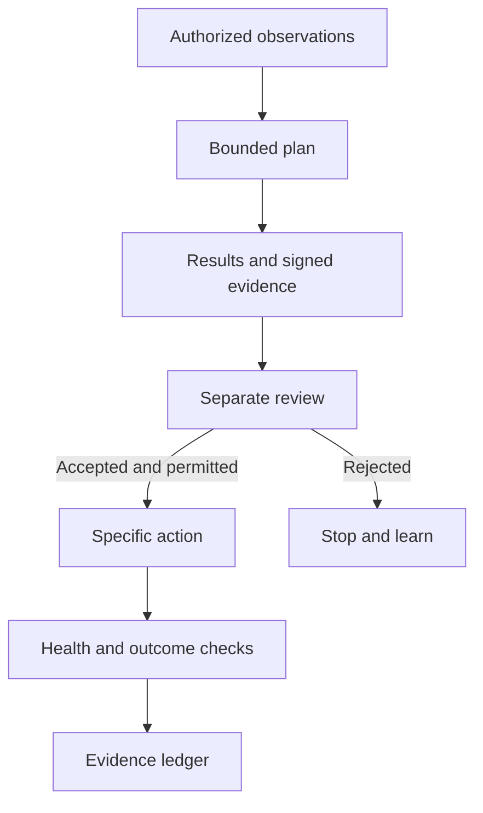

# AGI Alpha Node documentation

<!-- markdownlint-disable MD013 -->

**[Start with the welcoming website](https://montrealai.github.io/AGI-Alpha-Node-v0/)** — English and French, an illustrative example, larger text, and guided next steps.

## Choose your guide

| Your goal | Read this |
| --- | --- |
| Try your first local example | [Beginner guide](getting-started.md) · [Guide en français](getting-started.fr.md) |
| Configure a node | [Start here](../START_HERE.md) · [Runtime](alpha-runtime.md) |
| Understand the work formats | [Verified work](alpha-verified-work.md) |
| Review or qualify results | [Operations](alpha-operations.md) · [Qualification](alpha-qualification.md) |
| Back up or upgrade | [Recovery](alpha-recovery.md) |
| Deploy Ethereum contracts | [Deployment and verification](ethereum-deployment.md) |
| Understand capability limits | [Current status](project-status.md) |
| Maintain the public website | [Website, accessibility and scale](website.md) |
| Inspect release checks | [v3.3.0 evidence](../evidence/v3.3.0/validation.md) |

## Follow the evidence

The default runtime is the standalone **$AGIALPHA** project. AGI Jobs, USDC and OpenClaw are not prerequisites. The [legacy infrastructure codex](legacy-infrastructure.md) retains its original diagrams and integration references; its historical architecture and aspirational claims do not qualify current production operation.
